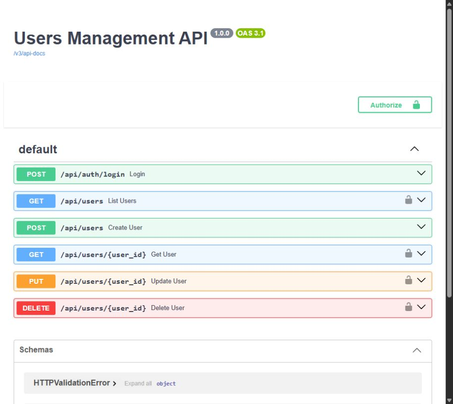
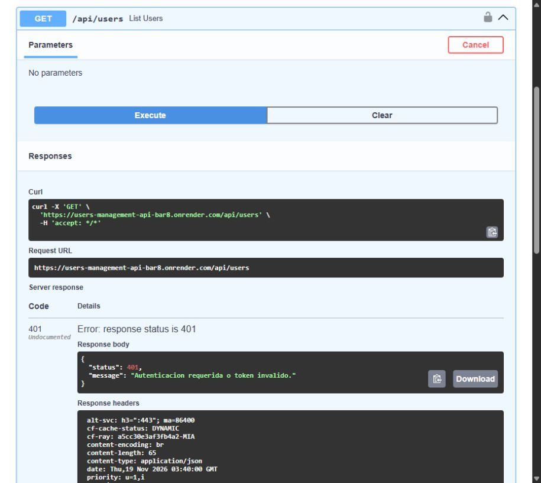
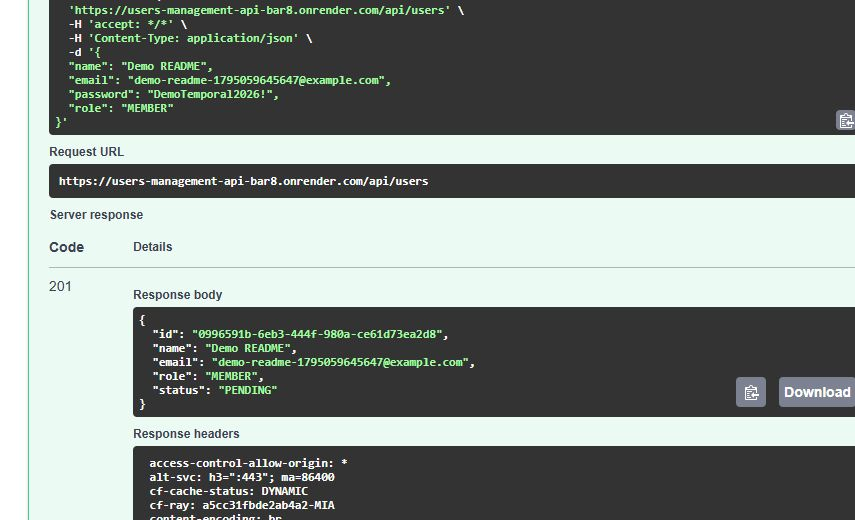
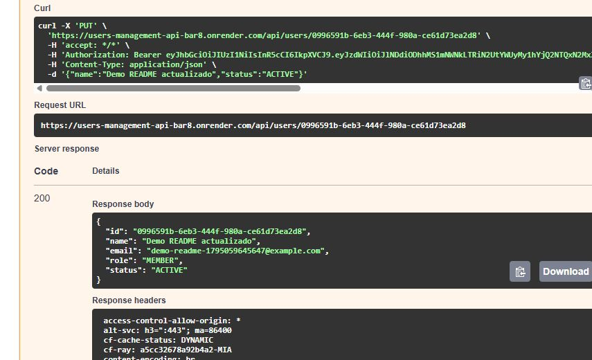
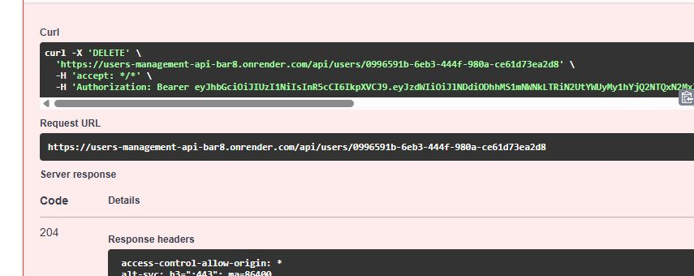

# users-management-fastapi-hexagonal

Microservicio de gestión de usuarios construido con Python, FastAPI y arquitectura hexagonal. Implementa los endpoints de la Guía 1 y está preparado para PostgreSQL local o Supabase mediante variables de entorno.

## Demostración pública

[Abrir Swagger en Render](https://users-management-api-bar8.onrender.com/swagger-ui/index.html)

Captura real de la documentación de la API desplegada:



[Ver video de evidencias (MP4)](docs/video/demo-evidencias.mp4). Es una secuencia de capturas reales de Swagger, sin audio; no es una grabación continua.

Pruebas realizadas contra Render el 19 de noviembre de 2026 (UTC), con un usuario exclusivo de demostración:

| Prueba | Resultado observado |
|---|---|
| Login del administrador | Token recibido correctamente |
| GET /api/users sin token | 401 |
| POST /api/users | 201, PENDING |
| PUT /api/users/{id} | 200, ACTIVE y nombre actualizado |
| GET /api/users/{id} con token | 200, cambios persistidos |
| DELETE /api/users/{id} | 204, registro de prueba eliminado con confirmación |

Estas pruebas verifican las respuestas HTTP y la persistencia; no verifican la recepción de correos en Brevo.

### Protección JWT



### Creación y actualización





### Eliminación del usuario de prueba



## Requisitos

- Python 3.12 o superior (el proyecto también es compatible con Python 3.13).
- PostgreSQL 15 o superior, local o administrado. Docker es opcional.
- Git.

## Instalación en Windows (PowerShell)

```powershell
py -3 -m venv .venv
.venv\Scripts\Activate.ps1
python -m pip install --upgrade pip
pip install -r requirements-dev.txt
Copy-Item .env.example .env
```

Edita `.env` con los datos de tu base de datos y genera el secreto JWT:

```powershell
python scripts\generate_jwt_secret.py
```

Copia el valor generado en `JWT_SECRET` y define `DB_PASSWORD` y `ADMIN_PASSWORD`. No subas `.env` a Git.

## Base de datos

Ejecuta `db/schema.sql` en PostgreSQL o en el SQL Editor de Supabase. Para Supabase usa **Connect → Session pooler** y copia los parámetros del proyecto:

```dotenv
DB_HOST=aws-<region>.pooler.supabase.com
DB_PORT=5432
DB_NAME=postgres
DB_USERNAME=postgres.<project-ref>
DB_PASSWORD=<solo-la-database-password>
DB_SSL_MODE=require
DB_SCHEMA=crud_usuarios
```

`DB_PASSWORD` contiene solamente la contraseña de base de datos, no la URI completa. Para conexión local sin TLS usa `DB_SSL_MODE=disable`.

En Render, usa los valores de **Connect → Session pooler** del mismo proyecto Supabase. El usuario debe incluir el identificador del proyecto, por ejemplo `postgres.<project-ref>`. Si el pooler responde `ENOIDENTIFIER` (no se recibió `external_id` o `sni_hostname`), confirma que `DB_USERNAME` no sea solo `postgres` y que coincida exactamente con el usuario mostrado por Supabase. Guarda las variables para que Render redespliegue el servicio.

## Crear el administrador y arrancar

```powershell
python scripts\seed_admin.py
uvicorn users_management.main:app --app-dir src --port 8080 --reload
```

La API está en `http://localhost:8080`; Swagger en `/swagger-ui/index.html` y OpenAPI en `/v3/api-docs`.

## Endpoints

| Método | Ruta | Acceso |
|---|---|---|
| POST | `/api/auth/login` | Público |
| POST | `/api/users` | Público |
| GET | `/api/users` | Bearer JWT |
| GET | `/api/users/{id}` | Bearer JWT |
| PUT | `/api/users/{id}` | Bearer JWT |
| DELETE | `/api/users/{id}` | Bearer JWT |

El proveedor de correo predeterminado es `console`: los mensajes se registran en la consola. `smtp` usa Gmail y una contraseña de aplicación. Las contraseñas nunca aparecen en las respuestas de usuario.

## Verificación

```powershell
pytest
ruff check .
```

La suite exige una cobertura mínima del 90 %.

## Postman

Importa `postman/users-management.postman_collection.json` y los entornos `Local.postman_environment.json` y `Remoto.postman_environment.json`. En el entorno Local completa `adminEmail` y `adminPassword`; la colección guarda el token después del login y `userId` después de crear el usuario. Completa `baseUrl` del entorno Remoto cuando la API se despliegue.

## Docker Compose local

`compose.yaml` levanta PostgreSQL y la API en contenedores. Define `LOCAL_DB_PASSWORD` en `.env` (puede ser distinta de la contraseña de Supabase) y ejecuta:

```powershell
docker compose up --build
```

## Despliegue en Render

Conecta el repositorio de GitHub en Render o crea un Blueprint usando `render.yaml`. Completa los valores `sync: false` del servicio con las variables de conexión de Supabase y secretos nuevos; no copies el `.env` local al panel. El despliegue automático sigue los cambios en `main`. Swagger permanece público y `GET /` requiere Bearer JWT, como en el contrato del taller.

La demostración de cambio de proveedor de la Guía 4 está en [`docs/db-provider-switch.md`](docs/db-provider-switch.md).

## Correo con Brevo (Guía 5)

El adaptador Brevo usa REST sobre HTTPS. Para activarlo, verifica un remitente en Brevo, define `BREVO_API_KEY`, `BREVO_FROM_ADDRESS` y `BREVO_FROM_NAME` en el entorno, y cambia `EMAIL_PROVIDER=brevo`. El envío usa tres intentos con backoff, circuit breaker y una cola en segundo plano; los límites se configuran con las variables `BREVO_*` de `.env.example`. Nunca guardes la API key en Git. El modo predeterminado `console` sigue disponible para desarrollo local.
